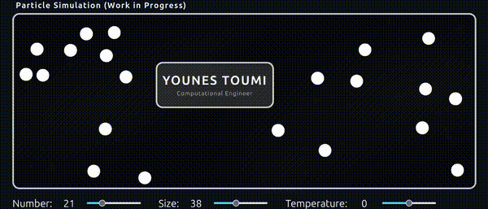
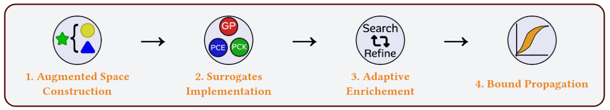

  

# Hello 👨‍🔬
I’m **Younes**, a **hybrid Engineer/Scientist** 💻 I enjoy experimenting in scientific computing!

# Current Project ~ 

A Julia-Package for surrogate modelling and propagation of imprecise probabilities.

# Contact Info

[][youtube]

[][linkedin]

[][buymeacoffee]

[youtube]: https://www.youtube.com/@YounesLab
[linkedin]: https://www.linkedin.com/in/younes-a-toumi/
[buymeacoffee]: https://buymeacoffee.com/youneslab

---
